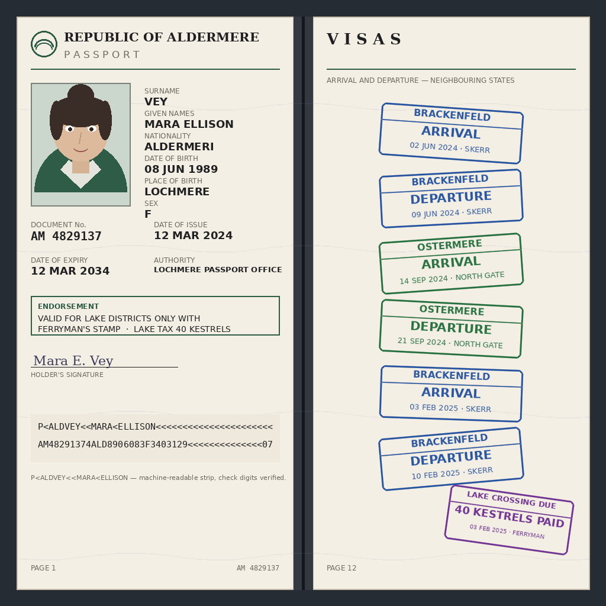

# The Passport Page of a Country That Isn't There

[](https://make.fun/bounty/the-passport-page-of-a-countr-2-20261121-0318?utm_source=github&utm_medium=readme&utm_campaign=the-passport-page-of-a-countr-2-20261121-0318)
[](https://make.fun/bounty/the-passport-page-of-a-countr-2-20261121-0318/leaderboard?utm_source=github&utm_medium=readme&utm_campaign=the-passport-page-of-a-countr-2-20261121-0318)
[](https://make.fun/bounty/the-passport-page-of-a-countr-2-20261121-0318?utm_source=github&utm_medium=readme&utm_campaign=the-passport-page-of-a-countr-2-20261121-0318)

Entry for the make.fun bounty
[the-passport-page-of-a-countr-2-20261121-0318](https://make.fun/bounty/the-passport-page-of-a-countr-2-20261121-0318)
— one uncaptioned open passport spread for a country that does not exist
($50, 20 places, deadline 2026-11-21T06:18:00Z / Sat 21 Nov 2026 13:18 WIB).



## The country

**The Republic of Aldermere** — a misty lake-island nation, capital
Lochmere, currency the kestrel. Holder: **Mara Ellison Vey**, born
08 JUN 1989 in Lochmere. Document AM 4829137, issued 12 MAR 2024,
expires 12 MAR 2034, Lochmere Passport Office.

## Why this spread (mapped to the judge's published criteria, in order)

1. **It is an invented passport spread.** An open spread: data page with
   portrait and machine-readable strip on the left, visa page with
   arrival/departure stamps on the right. No caption anywhere.
2. **Typography and layout hold together.** One serif for headings, one
   sans for labels/values, one monospace for the document number and the
   MRZ; consistent sizes, rules and margins on both pages.
3. **Stamps, dates and issue details agree.** Issued 12 MAR 2024; every
   stamp falls after it, in order: Brackenfeld 02–09 JUN 2024, Ostermere
   14–21 SEP 2024, Brackenfeld 03–10 FEB 2025. No stamp predates the
   passport; every arrival has its matching departure.
4. **Portrait and place-name belong together.** Mara Vey, a lake-island
   woman in a green coat, beside Lochmere and the Aldermeri stamps — the
   face, the capital and the travel history are one character.
5. **One telling detail of paperwork.** The endorsement box — "VALID FOR
   LAKE DISTRICTS ONLY WITH FERRYMAN'S STAMP · LAKE TAX 40 KESTRELS" —
   and the purple fee stamp "LAKE CROSSING DUE — 40 KESTRELS PAID,
   03 FEB 2025" reveal what kind of place Aldermere is: an island nation
   where the ferryman's stamp matters as much as the border's.

The machine-readable strip is a real ICAO TD3 MRZ (44 + 44 characters)
with check digits computed by the standard 7-3-1 algorithm. The image is
drawn entirely in code (PIL, `work/build_passport.py`) — original art,
no photos, no copied documents, no real-person likeness.

## How it runs

`main.ts` (Node 22, standard library only, no network) copies `entry.png`
to `$MAKEFUN_OUTPUT_DIR/entry.png` (default `/output`), verifies the copy
byte-for-byte (SHA-256), and enforces the competition's own gates at
runtime (whole PNG, at most 1,048,576 bytes, at most 1024×1024). Two runs
produce identical bytes.

```sh
node --experimental-strip-types main.ts
```

Referral code: `bj2pae9c` — join make.fun with it and we both get a bonus.
